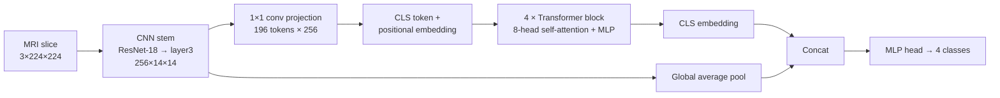

# Hybrid CNN–Vision Transformer for Brain Tumour MRI Classification

[](https://github.com/raiyanmuntasir/brain-tumor-hybrid-vit-cnn/actions/workflows/ci.yml)


A PyTorch implementation of a hybrid convolutional / Vision-Transformer classifier with multi-head self-attention. It classifies brain MRI slices as **glioma, meningioma, pituitary tumour or no tumour**, and includes Grad-CAM and attention-rollout explanations, matched CNN-only and ViT-only ablations, and a train/test leakage checker for the public dataset.

Open implementation accompanying:

> Monim, R. M., Islam, K., Asad, S. M., Hussain, M. A., Hossen, B., Manjar, M. T. A., & Sultana, S. (2026). *Generative AI for early disease detection: Hybrid ViT-CNN with multi-head attention in medical imaging.* Journal of Information Systems Engineering and Management, 11(2s), 655–676. https://doi.org/10.52783/jisem.v11i2s.14462

## Architecture



* **Why hybrid?** Convolutions give the inductive bias needed to learn local texture and edges from a few thousand slices. Self-attention over the 14×14 feature grid models long-range spatial context, such as lesion position relative to midline structures. Fusing the CLS embedding with pooled CNN features keeps both views available to the classifier.
* **Explainability:** Grad-CAM on the CNN stem shows *where* evidence was found. Attention rollout across the transformer layers shows *which regions the global reasoning attended to*. Both are saved for test images after training (`runs/<arch>/explanations.png`).
* **Ablations:** `--arch cnn` (same stem, no transformer) and `--arch vit` (pure ViT with 16×16 patches) use the identical training recipe, so the contribution of each component can be measured.

## Training recipe

AdamW (lr 3e-4, weight decay 0.05), linear warm-up followed by cosine decay, label smoothing 0.1, gradient clipping, mixed precision on GPU, and early stopping on validation macro-F1. The validation split is a stratified 15% of `Training/`. `Testing/` is evaluated exactly once, with the best checkpoint. Augmentation uses flips, small affine transforms and brightness/contrast jitter.

## Data

This repository uses the public **Brain Tumor MRI Dataset** (Nickparvar, Kaggle; 7,023 images assembled from the Figshare, SARTAJ and Br35H collections):

```bash
pip install kaggle      # needs a Kaggle API token
kaggle datasets download -d masoudnickparvar/brain-tumor-mri-dataset -p data/brain-tumor-mri --unzip
ls data/brain-tumor-mri    # expect: Testing  Training
```

> **Check for leakage before reporting results.** The merged sources contain near-duplicate slices across `Training/` and `Testing/`, a known reason for inflated accuracies in this literature. `python -m btvit.dedup --data-root data/brain-tumor-mri` reports them, and `--quarantine` moves them out of the test set.

## Usage

```bash
git clone https://github.com/raiyanmuntasir/brain-tumor-hybrid-vit-cnn.git
cd brain-tumor-hybrid-vit-cnn
pip install -r requirements.txt

# 1. CPU smoke test on random images (no data needed, ~1 min)
python -m btvit.train --fake --epochs 1 --img-size 64 --backbone light --out runs/smoke

# 2. Train the hybrid model (GPU recommended)
python -m btvit.dedup --data-root data/brain-tumor-mri --quarantine
python -m btvit.train --data-root data/brain-tumor-mri --arch hybrid --pretrained --epochs 30

# 3. Hybrid vs CNN vs ViT ablation, prints a results table
bash scripts/run_ablation.sh data/brain-tumor-mri

# Re-evaluate a checkpoint
python -m btvit.evaluate --checkpoint runs/hybrid/best.pt --data-root data/brain-tumor-mri
```

Each run writes `best.pt`, `history.csv`, `test_metrics.json` (accuracy, macro-F1, Cohen's κ, macro one-vs-rest ROC-AUC, per-class precision/recall/F1), `confusion_matrix.png` and `explanations.png`.

## Results

<!-- Fill in from scripts/run_ablation.sh after training on the de-duplicated test set. -->

| Model | Accuracy | Macro-F1 | Cohen's κ | Macro ROC-AUC |
|---|---|---|---|---|
| Hybrid CNN-ViT (this repo) | *pending* | *pending* | *pending* | *pending* |
| CNN only (ResNet-18 stem) | *pending* | *pending* | *pending* | *pending* |
| ViT only | *pending* | *pending* | *pending* | *pending* |

Training has not been run in this repository yet. The table will be filled from `scripts/run_ablation.sh`. The CI pipeline verifies, on every push, that the model builds, back-propagates through both the CNN and the transformer, can overfit a tiny batch, produces valid Grad-CAM and rollout maps, and completes an end-to-end training run on synthetic images.

## Layout

```
btvit/
  model.py     hybrid CNN-ViT, CNN-only and ViT-only models; transformer blocks with inspectable attention
  data.py      dataset loaders, augmentation, stratified validation split, synthetic loaders for CI
  train.py     training loop (AdamW, warm-up + cosine, AMP, early stopping) and final test evaluation
  evaluate.py  metrics, confusion matrix, checkpoint evaluation CLI
  explain.py   Grad-CAM and attention rollout, explanation gallery
  dedup.py     perceptual-hash leakage check between Training/ and Testing/
scripts/run_ablation.sh
tests/         unit and smoke tests (run in CI)
```

## Limitations

The model works on single 2-D slices from a public, multi-source dataset. It is not validated on clinical scanners, other sequences or 3-D volumes. Research code only, not a medical device.
